# Modern office symbols, cutaway

<!-- Generated by tools/office-assets/build.mjs. Do not edit; edit the files under symbols/ and run npm run office:assets. -->

One file per symbol under `symbols/light/` and `symbols/dark/`; each previews on its own and carries the paints it uses. Sizes are the drawn box in viewBox pixels. The bundles `symbols-light.svg` and `symbols-dark.svg` are generated from these files.

| Symbol | Light | Dark | Size |
| --- | --- | --- | --- |
| `art` | 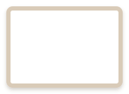 | 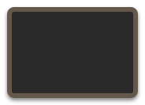 | 160 × 110 |
| `bookshelf` | 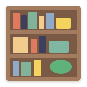 |  | 150 × 150 |
| `cafe` |  | 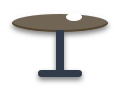 | 96 × 65 |
| `chair` | 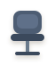 | 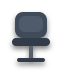 | 38 × 50 |
| `clock` | 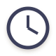 |  | 56 × 56 |
| `counter` | 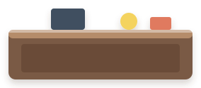 | 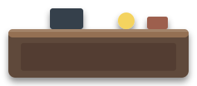 | 260 × 100 |
| `desk` | 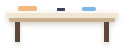 | 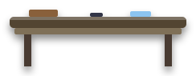 | 220 × 71 |
| `floor` | 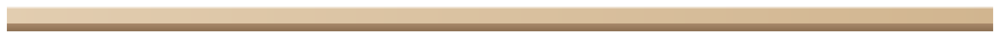 | 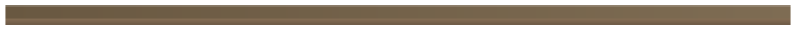 | 1720 × 44 |
| `kitchen` | 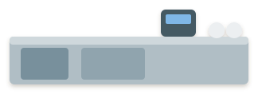 | 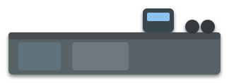 | 300 × 94 |
| `lamp` |  | 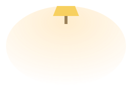 | 240 × 160 |
| `pillar` | 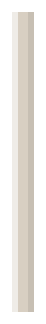 | 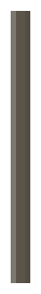 | 22 × 300 |
| `plant` |  |  | 90 × 96 |
| `rug` |  |  | 300 × 20 |
| `sofa` | 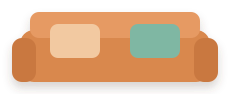 | 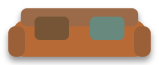 | 206 × 70 |
| `stool` | 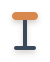 | 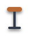 | 26 × 38 |
| `table` | 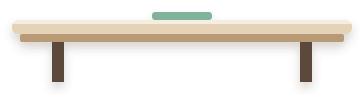 | 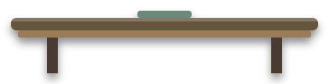 | 340 × 70 |
| `tallplant` | 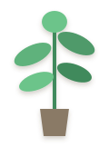 | 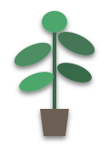 | 96 × 138 |
| `whiteboard` | 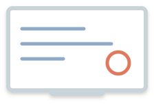 | 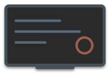 | 200 × 128 |
| `window` | 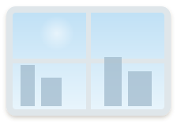 | 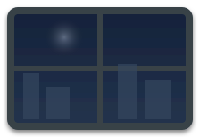 | 200 × 130 |
