# Galaxy symbols, top-down

<!-- Generated by tools/office-assets/build.mjs. Do not edit; edit the files under symbols/ and run npm run office:assets. -->

One file per symbol under `symbols/light/` and `symbols/dark/`; each previews on its own and carries the paints it uses. Sizes are the drawn box in viewBox pixels. The bundles `symbols-light.svg` and `symbols-dark.svg` are generated from these files.

| Symbol | Light | Dark | Size |
| --- | --- | --- | --- |
| `art` |  |  | 60 × 38 |
| `asteroid` | 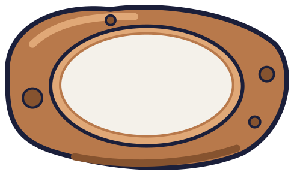 | 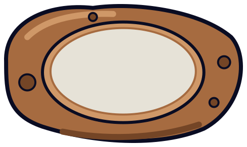 | 466 × 268 |
| `bookshelf` |  |  | 120 × 30 |
| `cafe` |  |  | 70 × 70 |
| `chair` |  |  | 36 × 36 |
| `clock` |  |  | 28 × 28 |
| `comet` | 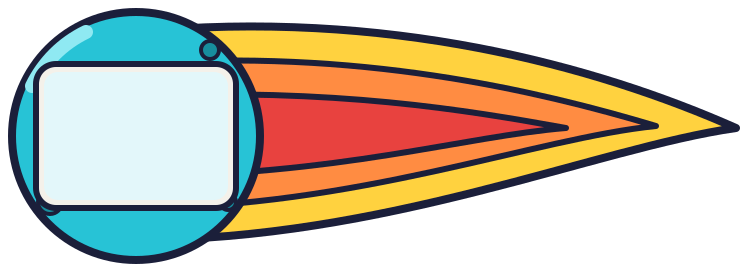 | 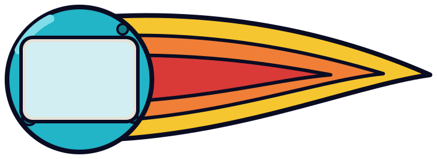 | 724 × 248 |
| `commandship` | 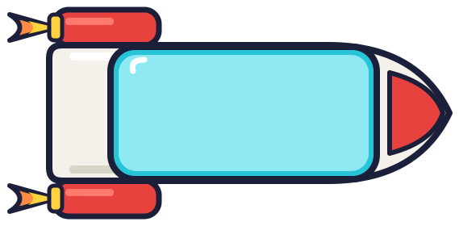 | 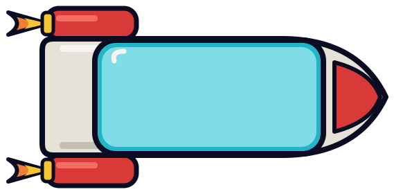 | 545 × 256 |
| `conveyor` |  |  | 180 × 18 |
| `counter` |  |  | 200 × 50 |
| `crane` | 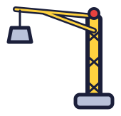 | 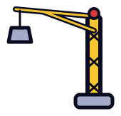 | 146 × 139 |
| `desk` |  |  | 120 × 60 |
| `dish` | 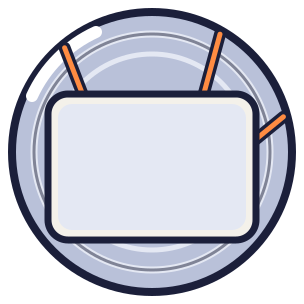 | 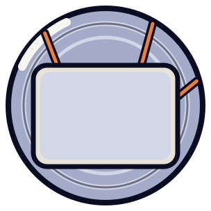 | 280 × 280 |
| `dome` | 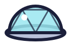 | 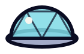 | 116 × 66 |
| `drill` |  | 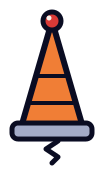 | 80 × 151 |
| `farplanet` |  |  | 119 × 66 |
| `flightpath` |  |  | 200 × 20 |
| `floor` |  |  | 128 × 128 |
| `gantry` | 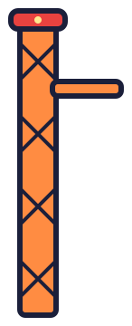 | 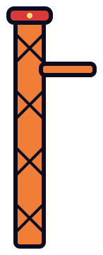 | 122 × 336 |
| `kitchen` |  |  | 220 × 50 |
| `lamp` |  |  | 60 × 60 |
| `launchpad` | 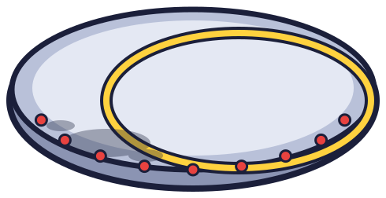 | 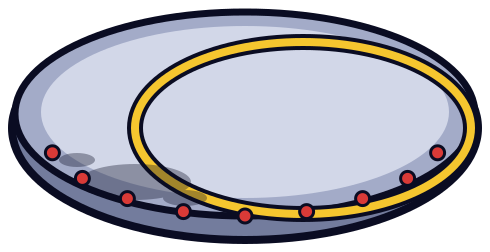 | 466 × 228 |
| `moonbase` | 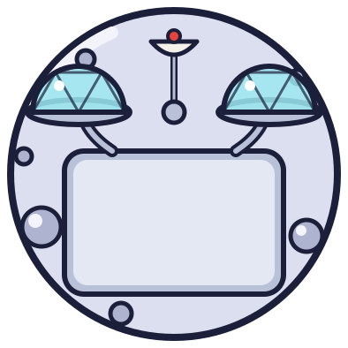 | 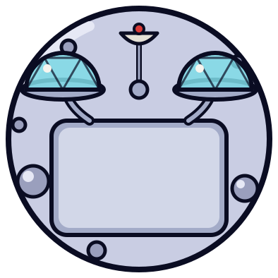 | 370 × 370 |
| `nebula` | 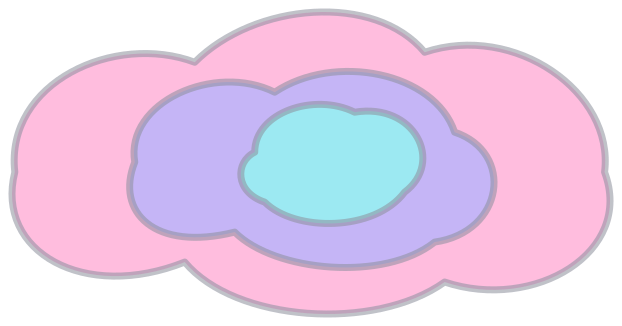 | 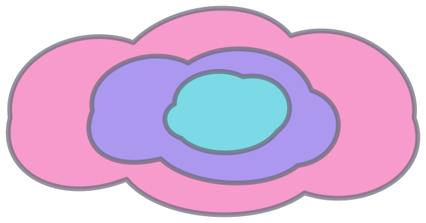 | 598 × 302 |
| `orecart` |  |  | 36 × 35 |
| `pillar` |  |  | 22 × 22 |
| `plant` |  |  | 44 × 47 |
| `ringroadplanet` | 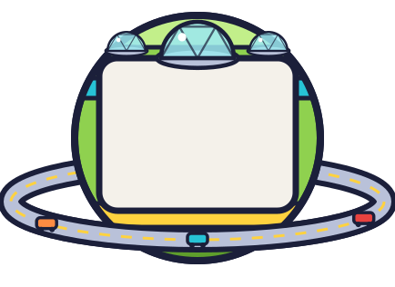 | 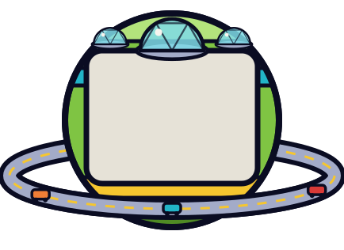 | 410 × 292 |
| `ringstation` | 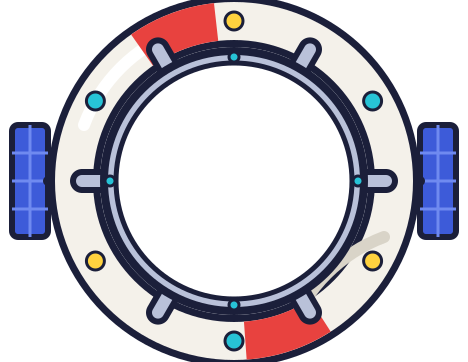 | 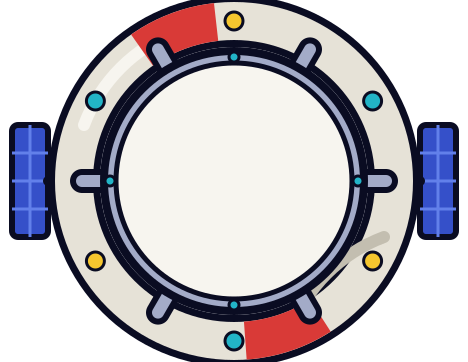 | 444 × 338 |
| `rocket` |  | 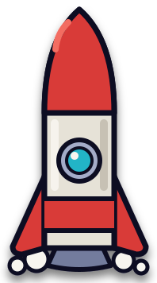 | 174 × 332 |
| `rug` | 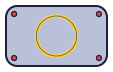 | 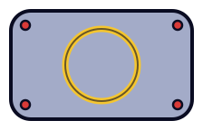 | 200 × 120 |
| `satellite` | 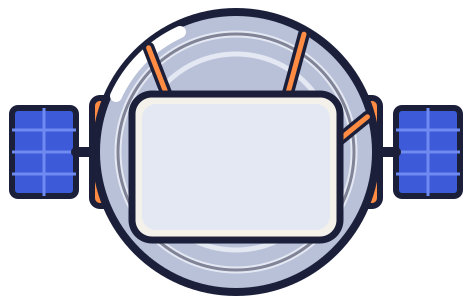 | 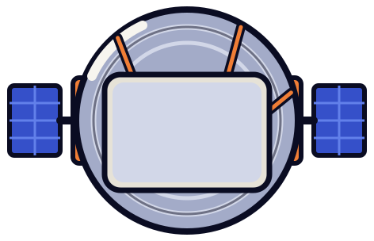 | 448 × 280 |
| `satwing` | 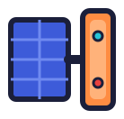 | 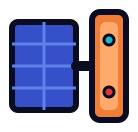 | 114 × 108 |
| `saucer` | 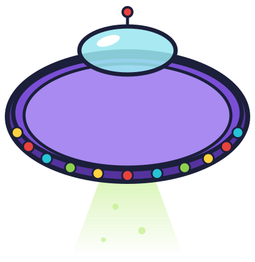 | 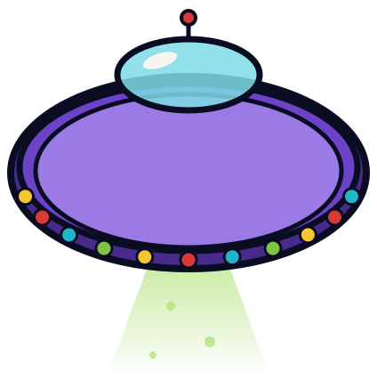 | 400 × 412 |
| `shuttle` |  | 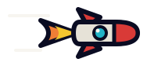 | 164 × 60 |
| `sofa` |  |  | 150 × 60 |
| `sparkle` |  |  | 28 × 28 |
| `stool` |  |  | 24 × 24 |
| `sun` | 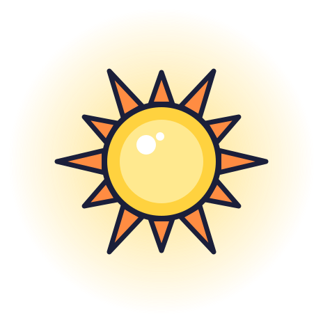 | 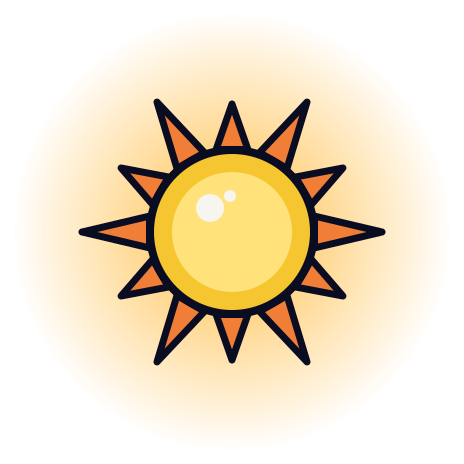 | 440 × 440 |
| `table` | 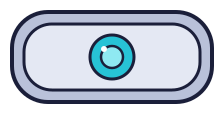 | 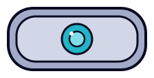 | 200 × 90 |
| `tallplant` |  |  | 62 × 67 |
| `tug` |  |  | 88 × 84 |
| `whiteboard` |  |  | 140 × 44 |
| `window` |  |  | 120 × 14 |
| `wormhole` | 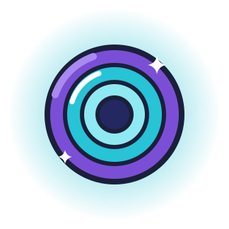 | 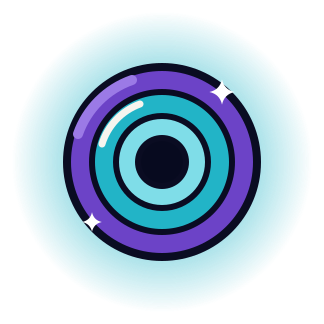 | 300 × 300 |
