# Underwater symbols, top-down

<!-- Generated by tools/office-assets/build.mjs. Do not edit; edit the files under symbols/ and run npm run office:assets. -->

One file per symbol under `symbols/light/` and `symbols/dark/`; each previews on its own and carries the paints it uses. Sizes are the drawn box in viewBox pixels. The bundles `symbols-light.svg` and `symbols-dark.svg` are generated from these files.

| Symbol | Light | Dark | Size |
| --- | --- | --- | --- |
| `anchor` |  | 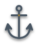 | 54 × 65 |
| `art` |  |  | 60 × 12 |
| `bookshelf` | 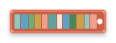 | 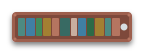 | 120 × 30 |
| `bubbles` |  | 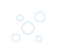 | 33 × 30 |
| `cafe` | 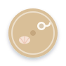 | 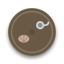 | 70 × 70 |
| `chair` |  | 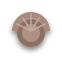 | 38 × 35 |
| `clock` |  |  | 38 × 38 |
| `coral` | 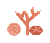 | 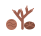 | 58 × 48 |
| `counter` | 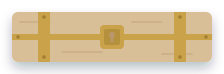 | 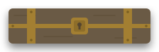 | 200 × 50 |
| `desk` |  | 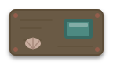 | 120 × 60 |
| `fish` | 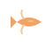 | 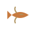 | 35 × 26 |
| `floor` | 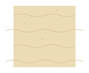 | 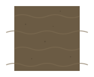 | 160 × 128 |
| `kitchen` | 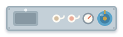 | 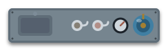 | 220 × 50 |
| `lamp` |  | 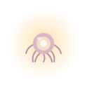 | 100 × 100 |
| `pillar` |  |  | 24 × 24 |
| `plant` |  |  | 48 × 44 |
| `rock` | 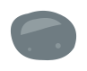 |  | 74 × 55 |
| `rug` | 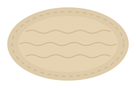 | 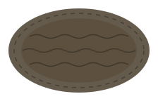 | 200 × 120 |
| `sofa` | 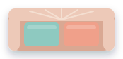 | 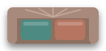 | 150 × 60 |
| `stool` | 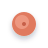 | 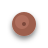 | 24 × 24 |
| `table` | 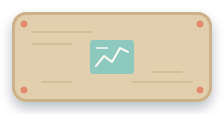 | 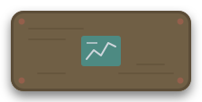 | 200 × 90 |
| `tallplant` | 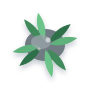 |  | 66 × 66 |
| `whiteboard` | 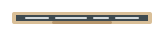 | 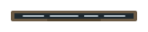 | 140 × 12 |
| `window` |  |  | 120 × 14 |
